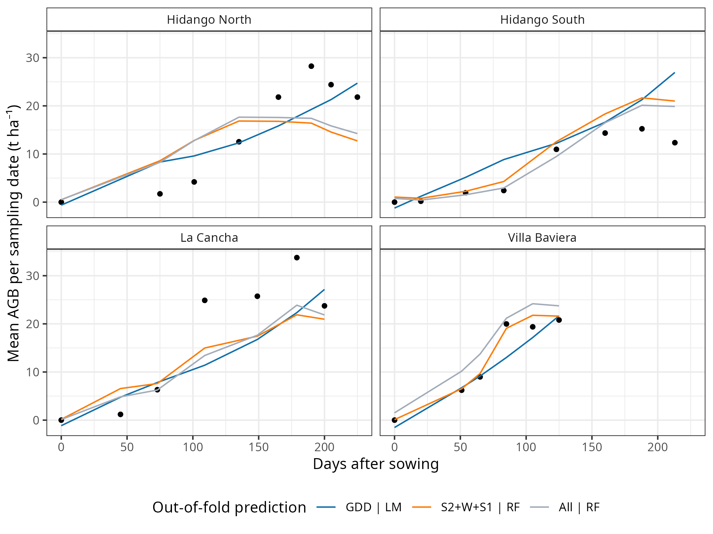
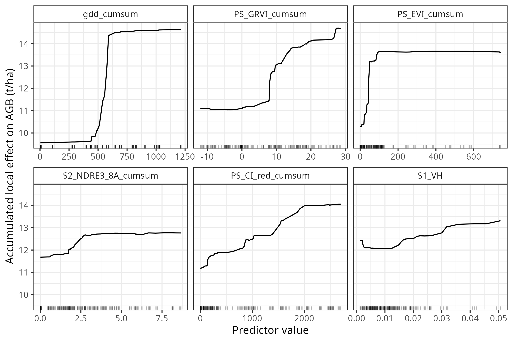

# Introduction

As the world population is projected to reach 9.8 billion by 2050 [@UN2024], food security is expected to face significant challenges [@Bahar2020], which are further intensified by climate change [@Chen2025]. Wheat (*Triticum aestivum*) is one of the main staple crops worldwide, and its production is key for food security [@FAO2025]. Furthermore, droughts significantly impact agriculture, as evidenced by the decrease in crop yield [@Santini2022; @Naumann2021; @Mishra2015]. Global wheat production could drop by 13% by mid-century under climate change [@Pequeno2024]. Quantifying above-ground biomass (AGB) allows farmers and agencies to monitor and optimize agricultural processes [@Dietz2021]. Proxies of vegetation productivity derived from vegetation indices can help monitor and predict the impact of drought at a regional scale [@Zambrano2021; @Zambrano2018; @Zambrano2016]. However, on a farm level, we must quantify this impact using crop yield as a productivity metric, which can aid in determining the economic impact of seasonal variations in crop yield. Generally, the estimation and monitoring of agricultural production is made by using three methods: i) crop growth models [@Lobell2010; @Wang2023], ii) surveys [@Gardner1980], and iii) in-situ measurements. The models help predict how crops will grow, yield, and produce under different environmental and management conditions, which is useful for forecasting food supply and understanding how climate change and policy decisions affect global agriculture, but the downside is that they require many different variables to obtain meaningful results. The objective of the surveys is to collect timely and reliable data from the agricultural sector in order to carry out statistical studies of crops, but it provides summaries at administrative units (e.g., states, districts) [@Gardner1980]. Additionally, field measurements provide reliable data, known as the ground truth, that can be used for comparison with models and surveys; however, this process is costly and time-consuming.

The use of empirical models that are based solely on remote sensing sources has become a straightforward option for the estimation of crop yield, especially for cereals [@Lischeid2022]. There are multiple remote sensing methods to estimate AGB, among which the methods based on multispectral imaging [@Marshall2022; @Segarra2022], Synthetic Aperture Radar (SAR) [@Hu2024; @Chao2019], LiDAR (Light Detection and Ranging) [@Bates2021], hyperspectral [@Yue2021], or combination of them [@Li2024; @David2022; @Wang2016], stand out, offering promising results. Estimation methods based on SAR data focus on the measurement of the structure of the crop, soil moisture, and their temporal variations. An advantage of this technique is that it can penetrate the cloud cover, allowing a constant measurement in the study area; its disadvantage is the angle of observation to the crop and the speckle noise inherent to the signal [@Lopes1990; @Maghsoudi2012; @Moran1997]. Estimation methods based on LiDAR and hyperspectral data focus on the measurement of the crop structure and phenological monitoring of the crop [@Brovkina2017; @Luo2017; @Wang2016]. Its main disadvantage is the high cost of implementation, which limits its proliferation. Another common approach is the use of spectral indices (e.g., NDVI, EVI, etc.) derived from optical sensors such as Sentinel-2 [@David2022] for specific dates. Furthermore, the use of accumulated spectral indices [@PeroniVenancio2020] over the growing season has shown improvements in estimating biomass/yield compared with using indices just for specific dates. The main advantage is its simplicity and strong correlation with the observed biomass. Currently, the research about estimating biomass is moving forward integrating Sentinel 1 & 2 [@Uribeetxebarria2023], LiDAR, hyperspectral, and Landsat missions [@Zhang2023; @He2018], which aids in better monitoring of the crop's growth stages [@Shen2023].

Effective machine learning (ML) methods, along with remote sensing data, are increasingly used to estimate the AGB in various cereals, including wheat. In Southern Brazil, @AtkinsonAmorim2022 collected images from unmanned aerial vehicles (UAV) and used random forest, support vector regressions, and neural networks to estimate AGB in wheat. Their results reached a R² of 0.90 and a root mean square error (RMSE) of 0.83 t/ha. In another study, @Liu2024 used spectral data obtained from UAV, phenological information, and multiple machine learning algorithms to estimate AGB on wheat, having results of an R² ranging from 0.84 to 0.91 and an RMSE of 1.69 to 2.11 t/ha. Considering another approach, @Marshall2022 used hyperspectral and Sentinel-2 data and applied random forest and partial least squares to estimate wheat AGB on different stages of the crop. Their results achieve an R²=0.81 and RMSE=3.7 t/ha with the random forest model. Further, for different types of grass cover, Sentinel-1 has been tested to estimate AGB with varied results [@David2022; @Li2024; @Nuthammachot2022]. The benefits of SAR Sentinel-1 are that it can gather dependable data even on cloudy days, which is not possible with optical sensors like Sentinel-2 and Landsat. Additionally, Sentinel-1's backscatter is closely linked to the dielectric constant, making it a proxy of soil moisture [@Fan2025; @Zhu2024], and, therefore, the amount of water crops can absorb from the soil, which affects their growth. Its usefulness for AGB prediction therefore deserves evaluation.

Most of these studies evaluate models with random or within-site data splits. When the goal is to apply a model to fields not used for training, such splits overestimate accuracy, because samples from the same field and season share soil, management, weather, and image acquisition conditions [@Roberts2017; @Ploton2020]. Spatial or grouped cross-validation, in which entire sites are held out, gives a more realistic estimate of transferability [@Meyer2021]. A second and less discussed issue is the choice of reference. Crop AGB increases through most of the growing season, so any predictor that tracks season progress, including accumulated thermal time and cumulative vegetation indices, can be strongly correlated with AGB without carrying information about crop condition. Without a phenological baseline evaluated under the same validation scheme, it is not possible to tell whether satellite predictors add information beyond this seasonal trend.

Here, we evaluate how much multi-sensor remote sensing (Sentinel-1, Sentinel-2, and PlanetScope), precipitation, and soil moisture add to accumulated thermal time for estimating in-season wheat AGB at site-seasons not used for training. Using destructive AGB samples from four Mediterranean wheat field-seasons in central Chile, we pursued three specific objectives: i) quantify the transferability of two phenological baselines, days after sowing and accumulated growing degree days, under leave-one-site-season-out cross-validation; ii) compare these baselines with ML models built on single sensors, on sensors combined with thermal time or weather, and on all predictors; and iii) identify the predictors and sensor groups that drive held-out performance using permutation importance and accumulated local effects.

# Materials and Methods

## Study Area

The study was conducted during the 2020 to 2023 growing seasons (June to January) across four wheat field sites (*Triticum* *aestivum*) located in central Chile: i) La Cancha in the Metropolitan region, ii) Hidango in the O'Higgins region (two different fields in two seasons), and iii) Villa Baviera in the Maule region. Sampling took place in delineated fields at each site (@fig-1). In Hidango, separate fields were established for the 2021-2022 and 2022-2023 seasons; in Villa Baviera and La Cancha, sampling occurred during the 2020-2021 and 2022-2023 seasons, respectively. To capture within-field spatial variability, sampling points were placed at random locations within each field, with the constraint that they covered the whole field area: five in La Cancha, Villa Baviera, and the northern Hidango field (2021 to 2022 season); and six in the southern Hidango field (2022 to 2023 season) (@fig-1).

{#fig-1 width="100%"}

A variety of spring wheat was planted in Villa Baviera (Llareta-INIA; [@Garrido2013]), while the other sites had winter wheat (Irafen-INIA and Pantera-INIA; [@DelPozo2023]). Spring wheat is typically sown in late winter or early spring and harvested within the same year, whereas winter wheat is sown in autumn, requires vernalization, and is harvested the following summer [@Liu2025; @Zhao2022]. According to the FAO--UNESCO Soil Map of the World [@FAO2014]; La Cancha is characterized by shallow, fine-textured Regosols on nearly flat terrain; Hidango presents fine-textured Luvisols on gently undulating landscapes; and Villa Baviera features deep, well-structured Nitisols on slightly sloped land. The climate in these regions is Mediterranean with winter rainfall (Csb) under the Köppen--Geiger classification [@Beck2023]; Hidango, however, exhibits an oceanic influence. Mean annual precipitation ranges from 700 to 900 mm, with average temperatures between 11 and 12 °C.

## Data acquisition and processing

### Field data

AGB, defined as the total dry mass of dead and living plant organs per unit ground area [@Chave2014], was sampled at distinct wheat phenological stages across each season. Phenological stages were identified using the Zadoks scale, which describes 10 principal growth stages from sowing to ripening [@Zadoks1974]. At each sampling point (@fig-1), biomass from a 0.25 m² area was harvested, dried in a forced-air oven at 70°C for three days, weighed on a precision scale, and converted to t/ha. Sampling intervals were planned to capture variability across growth stages, ensuring representative data for each field and season. The temporal distribution of sampling dates across phenological stages is illustrated in @fig-2, with NDVI time series indicating canopy development over the season. A total of 153 AGB wheat samples were collected: 88 in Hidango (40 in 2021 to 2022 and 48 in 2022-2023), 35 in La Cancha, and 30 in Villa Baviera.

![**Above-ground biomass (AGB) sampling dates across the seasons and fields.** Zadoks scale, with NDVI included to illustrate changes in canopy vigor throughout the seasons. S = Sowing, SG = Seeding Growth, T = Tillering, SE = Stem Elongation, B = Booting, E = Ear Emergence, F = Flowering, M = Milk Development, D = Dough Development, and R = Ripening. AGB sampling dates are labeled S~1~, S~2~, ..., S~n~ (subscripted), where n is the total number of samples collected during the season; these are distinct from the unsubscripted "S" (Sowing) Zadoks stage label above. S~SOS~ indicates the start of the season (SOS) when AGB = 0, and S~final~ represents AGB at harvest.](../output/figs/fenology_and_biomass_new_v2.png){#fig-2 width="100%"}

Additionally, soil moisture was measured using TEROS 12 sensors (METER Group, USA), which operate via a capacitance/frequency domain method to assess dielectric permittivity, achieving ±1% accuracy in typical mineral soils [@Fragkos2024]. The sensors were installed at a central point within each field's sampling area at depths of 15, 30, and 45 cm in La Cancha and Villa Baviera, and 15, 50, and 75 cm in Hidango in both seasons. Each sensor recorded data at 30-minute intervals, and daily values were computed by averaging the measurements from each day.

Soil water content (cm³/cm³) from each sensor was converted to water depth (mm) by multiplying it by the thickness of the soil layer that the sensor represents (Hidango: 300 mm for the 15 cm sensor and 250 mm for the 50 cm sensor; La Cancha and Villa Baviera: 200, 150, and 200 mm for the 15, 30, and 45 cm sensors), so that the represented layers span 0 to 55 cm at every site. The 75 cm sensor in Hidango lies below this depth and was not used. The daily soil moisture predictor (SM, mm) is the mean water depth across the represented layers. Because each field had a single sensor profile, SM varies in time but is identical for all sampling points and map pixels within a field.

### Weather Data

Precipitation and temperature data were obtained from automatic meteorological stations managed by the Red Agrometeorológica de Chile. This national network provides continuous, open-access weather data for agricultural use (http://agromet.inia.cl; http://agrometeorologia.cl), recording several meteorological variables at hourly intervals. Each station is equipped with a Texas Electronics TE525MM-L25 tipping-bucket rain gauge for precipitation and a Vaisala HMP60-L11 sensor for air temperature and relative humidity [@ChaconC2019]. For each study site, the nearest meteorological station was selected (@tbl-1), and hourly precipitation and air temperature data were downloaded starting from the sowing date.

\begin{table}[ht]
\centering
\caption{Meteorological stations used for each field, including the station code and name, the operating institution (Inst.), its coordinates, and its distance from the corresponding field (Dist.).}
\label{tbl-1}
\begin{tabular}{|l|l|l|l|S[table-format=2.2, table-comparator=true] | S[table-format=2.2] | S[table-format=2.2]|}
\hline
\textbf{Field} & \textbf{Code} & \textbf{Name} & \textbf{Inst.} & \textbf{Lat (°S)} & \textbf{Lon (°W)} & \textbf{Dist. (km)} \\ \hline
Hidango & 260 & Hidango & INIA & 34.10 & 71.80 & 1.03 \\ \hline
La Cancha & 50 & Chocalan & FDF & 33.73 & 71.21 & 1.16 \\ \hline
Villa Baviera & 103 & Parral Norte & FDF & 36.23 & 71.73 & 20.89 \\ \hline
\end{tabular}
\begin{flushleft}
\footnotesize
Inst.: institution operating the station; INIA: Instituto de Investigaciones Agropecuarias; FDF: Fundación para el Desarrollo Frutícola. Dist.: distance between the station and the corresponding field.
\end{flushleft}
\end{table}

Daily precipitation (mm) was cumulatively summed over the growing season to obtain daily accumulated precipitation (mm, $\sum$PP). Daily minimum (Tmin) and maximum (Tmax) temperatures were used to compute Growing Degree Days (GDD):

$$GDD  =  \frac{\left( T_{\max} + T_{\min} \right)}{2} - T_{base}$$

A base temperature of 2°C was applied for the early growth stages (sowing to tillering), while 6°C was used for reproductive stages (stem elongation to ripening) [@DelPozo1987]. Negative GDD values were set to zero. Then, the accumulated GDD values were calculated by summing the daily GDD from the start of the season of each field ($\sum$GDD).

### Remote Sensing Data

Satellite time series imagery from three missions, Sentinel-1, Sentinel-2, and PlanetScope, were used to derive predictors for aboveground biomass (AGB) modeling. These datasets include radar and optical sensors, covering different spectral ranges (SAR, visible, NIR, SWIR) and having different spatial resolutions.

The Sentinel‑1 (S1) mission, operated by the European Space Agency (ESA), consists of a constellation of C-band synthetic aperture radar (SAR) satellites that operate in several acquisition modes (Interferometric Wide [IW], Extra Wide [EW], and Stripmap [SM]), with spatial resolutions ranging from 5 to 40 m and a swath width up to 410 km. Data acquisition is independent of cloud cover or sunlight, enabling consistent time-series generation under any weather condition. We used Level‑1 Ground Range Detected (GRD) products from Sentinel‑1A (S1A) and, until its failure on 23 December 2021, Sentinel‑1B (S1B); after that date only S1A was available, because Sentinel‑1C was not launched until December 2024. GRD products are radiometrically calibrated, multi-looked, and terrain-corrected using a digital elevation model, then projected to the WGS84 datum (Table `\ref{tbl-2}`{=latex}). These products are delivered in dual-polarization (VV, VH or HH, HV), depending on the acquisition mode and region, with a pixel spacing of 10 to 40 m [@Torres2012].

Sentinel‑2 (S2) is a dual-satellite optical mission carrying the MultiSpectral Instrument (MSI), which captures 13 spectral bands across the visible, near-infrared (NIR), and shortwave infrared (SWIR) regions. Spatial resolution varies by band (10, 20, or 60 m), and the system provides global coverage with a revisit time of ~5 days at the Equator. We used Level‑2A surface reflectance products, which are atmospherically corrected (bottom-of-atmosphere, BOA) and orthorectified (Table `\ref{tbl-2}`{=latex}). These products include cloud and shadow masks, aerosol optical thickness (AOT), and water vapor content layers, along with scene classification maps and pixel-level quality information [@Drusch2012].

\begin{table}[ht]
\small
\centering
\caption{Summary of satellite data used to derive predictors for AGB estimation. For Sentinel-2, paired wavelength values give the Sentinel-2A / Sentinel-2B central wavelengths, respectively; for Sentinel-1, the C-band wavelength is expressed in nm (5.546e7 nm $\approx$ 5.55 cm) for consistency with the optical sensors. Blank cells in the Revisit (d) column repeat the value given in the first row of each sensor block.}
\label{tbl-2}
\begin{tabularx}{\textwidth}{l l l l S[table-format=4.1] S[table-format=1]}
\toprule
\textbf{Dataset} & \textbf{Collection} & \textbf{Bands} & \textbf{Wavelength (nm)} & \textbf{Res. (m)} & \textbf{Revisit (d)} \\
\midrule
\multirow{2}{*}{Sentinel-1} & \multirow{2}{*}{GRD} & VV & 5.546e7 (C-Band) & 10 & 6 \\
 &  & VH & 5.546e7 (C-Band) & 10 & \\
\midrule
\multirow{13}{*}{Sentinel-2} & \multirow{13}{*}{Level-2A} & 1 - Coastal & 442.7 / 442.2 & 60 & 5 \\
 &  & 2 - Blue & 492.7 / 492.3 & 10 & \\
 &  & 3 - Green & 559.8 / 558.9 & 10 & \\
 &  & 4 - Red & 664.6 / 664.9 & 10 & \\
 &  & 5 - RE1 & 704.1 / 703.8 & 20 & \\
 &  & 6 - RE2 & 740.5 / 739.1 & 20 & \\
 &  & 7 - RE3 & 782.8 / 779.7 & 20 & \\
 &  & 8 - NIR & 832.8 / 832.9 & 10 & \\
 &  & 8A - Narrow NIR & 864.7 / 864.0 & 20 & \\
 &  & 9 - Water vap. & 945.1 / 943.2 & 60 & \\
 &  & 10 - Cirrus & 1373.5 / 1376.9 & 60 & \\
 &  & 11 - SWIR1 & 1613.7 / 1610.4 & 20 & \\
 &  & 12 - SWIR2 & 2202.4 / 2185.7 & 20 & \\
\midrule
\multirow{8}{*}{PlanetScope} & \multirow{8}{*}{Level 3B SR} & 1 - C. Blue & 441.5 & 3 & 1 \\
 &  & 2 - Blue & 490.0 & 3 & \\
 &  & 3 - Green I & 531.0 & 3 & \\
 &  & 4 - Green & 565.0 & 3 & \\
 &  & 5 - Yellow & 610.0 & 3 & \\
 &  & 6 - Red & 665.0 & 3 & \\
 &  & 7 - Red Edge & 705.0 & 3 & \\
 &  & 8 - NIR & 865.0 & 3 & \\
\bottomrule
\end{tabularx}
\end{table}

PlanetScope (PS) is a commercial constellation of ~120 CubeSats operated by Planet Labs, which capture daily multispectral imagery at a nominal resolution of 3 m. The constellation includes different sensor types deployed over time, such as Dove-C (three- or four-band imagers with a split-frame NIR filter), Dove-R (four-band imagers with a butcher-block filter), and SuperDove (eight-band imagers including the visible, NIR, and Red Edge bands). We used Level‑3B Surface Reflectance products, which are orthorectified and atmospherically corrected using Planet's in-house model based on global aerosol assumptions. Although not fully corrected for haze or thin cirrus clouds, the products are radiometrically calibrated, georeferenced to sub-pixel accuracy, and delivered with metadata and quality indicators [@Roy2021]. Due to the sensor transition that occurred during the study period, both Dove and SuperDove imagery were included. The four bands common to all sensor types (Blue, Green, Red, and NIR) were used for all site-seasons. The SuperDove red edge band (705 nm) was also retained, but it was available only for the Hidango 2022-2023 and La Cancha 2022-2023 site-seasons; for Hidango 2021-2022 and Villa Baviera 2020-2021, the red edge band and the four PlanetScope predictors derived from it (PS~B5~, PS~TCARI/OSAVI~, PS~MCARI/OSAVI~, PS~NDRE/NDVI~) were entirely missing. Because values imputed for an entire site-season cannot carry information about that site-season, these four predictors were excluded from the analyses (Section 2.3.2).

S1 Ground Range Detected (GRD) imagery was accessed via Google Earth Engine; S2 Level-2A products were obtained from the Planetary Computer; and PS imagery was acquired through the Planet Explorer platform, excluding images with cloud cover over the fields. A total of 185 S1, 208 S2, and 180 PS images were used across the four fields in their respective seasons: Hidango 2021-2022 (S1: 52; S2: 60; PS: 47), Hidango 2022-2023 (S1: 56; S2: 56; PS: 40), La Cancha 2022-2023 (S1: 43; S2: 53; PS: 41), and Villa Baviera 2020-2021 (S1: 34; S2: 39; PS: 52).

### Preprocessing of remote sensing data

For data preprocessing, Sentinel-1 backscatter values (VV and VH) were first converted from decibels to linear scale, and the VH/VV polarization ratio was then computed. No additional masking was applied to Sentinel-1, as its GRD products undergo standard preprocessing, including radiometric calibration, multi-looking, and orthorectification. An Important limitation is that Sentinel-1 data were used without speckle filtering or incidence angle normalization, which are standard preprocessing steps for SAR vegetation applications. This may have affected S1 performance, and S1 results should be interpreted cautiously. For Sentinel-2 and PlanetScope, reflectance values were scaled by dividing by 10,000, and values outside the [0.01, 1] range were discarded. Low-quality Sentinel-2 pixels were identified using the Scene Classification Layer (SCL), excluding classes 0, 1, 2, 3, 8, 9, and 10. For PlanetScope, the Universal Data Mask (UDM) was used to retain only clear-sky pixels.

All variables were interpolated to create continuous daily time series, ensuring they aligned with AGB sampling dates and allowing for biomass estimation at consistent temporal offsets across different fields and seasons. For Sentinel-1, VV, VH, and VH/VV ratio were temporally extended by duplicating each acquisition across the days until the midpoint to the following observation. For Sentinel-2 and PlanetScope, spectral bands were interpolated using a Kalman smoothing approach [@Moritz2017], which uses observations both before and after each date, and cumulative sums were computed from the start of each season. Because of this two-sided smoothing, the daily predictors are suitable for in-season estimation but would need a causal filter for real-time applications. Daily values from all sources, and cumulative sums for Sentinel-2 and PlanetScope, were extracted at sampling locations and later used as input variables for AGB estimation. Extraction was performed at each sampling point's coordinates as the value of the raster cell containing the point (nearest-pixel extraction, with no spatial averaging over a buffer); given the 0.25 m² plot size relative to the 3-60 m sensor resolutions, each sampling plot is fully contained within a single pixel for every sensor.

### Selection and processing of VIs

A total of 53 vegetation indices (VIs) were selected to estimate AGB using the daily interpolated S2 and PS data (Table `\ref{tbl-3}`{=latex}). Daily cumulative sums of these VIs were also computed from the start of each season to capture integrated vegetation dynamics. Furthermore, 36 of these 53 VIs originally derived from the B8 band were recalculated using the B8A band (available only for S2) to assess potential differences in vegetation response between these two near-infrared bands, resulting in a total of 89 VIs across both products. The selection criteria were: (1) demonstrated utility for crop biomass estimation or yield prediction in peer-reviewed literature, with particular emphasis on wheat, forage, maize, and other cereals [@Peng2023; @Segarra2022; @Uribeetxebarria2023; @Wang2022; @Wu2008; @Zheng2017]; (2) computational feasibility from available Sentinel-2 and PlanetScope spectral bands; and (3) conceptual diversity to capture different aspects of canopy condition, including greenness and chlorophyll content (NDVI, EVI, GNDVI), red edge response (NDRE variants, CI$_{red}$), canopy structure (OSAVI variants, SR), water content (WI, SIPI), and photosynthetic efficiency proxies (MCARI, TCARI combinations). This selection represents a subset of available VIs from the literature and was made prior to any analysis of the AGB data, ensuring that predictor choice was independent of model performance. Both daily values and cumulative VIs were used as predictor variables in the modeling framework.

Table `\ref{tbl-3}`{=latex} gives the formulas of the vegetation indices (VIs) retained as candidate predictors after removing highly intercorrelated indices; the remaining VIs are listed in Supplementary Material Table S1. The final set of candidate predictors, including bands and cumulative indices, is described in Section 2.3.2 and Table `\ref{tbl-4}`{=latex}.

\begin{table}[!htbp]
\footnotesize % Smaller font size
\centering
\caption{Vegetation indices selected for AGB modeling after removing highly correlated variables (see Supplementary Material Table S1 for the full candidate set). The Dataset column indicates the source product(s) used to compute each index; an asterisk (*) marks indices for which the Sentinel-2 formula uses the narrow NIR band B8A in place of the standard NIR band B8 (Section ``Selection and processing of VIs'').}
\label{tbl-3}
\renewcommand{\arraystretch}{1.1} % Tighter row spacing
\begin{tabularx}{\textwidth}{@{} c l l l X l @{}}
\toprule
\textbf{N°} & \textbf{Dataset} & \textbf{Name} & \textbf{Abbr.} & \textbf{Formula} & \textbf{Ref.} \\
\midrule
1 & S2 & OSAVI Variant & OSAVI$_2$ & $\frac{1.16 \cdot (RE_3 - Red)}{(RE_3 + Red + 0.16)}$ & \cite{Jin2020} \\
2 & S2 & - & MCARI/OSAVI$_2$ & $MCARI/OSAVI_2$ & \cite{Wu2008} \\
3 & S2 & SWIR 11 MCARI & MCARI$_{SW11}$ & $((RE_1 - SW_1) - 0.2(RE_1 - G)) \cdot (RE_1/SW_1)$ & \cite{Herrmann2011} \\
4 & S2 & SWIR 11 TCARI & TCARI$_{SW11}$ & $3((RE_1 - SW_1) - 0.2(RE_1 - G) \cdot (RE_1/SW_1))$ & \cite{Herrmann2011} \\
5 & S2 & SWIR 12 MCARI & MCARI$_{SW12}$ & $((RE_1 - SW_2) - 0.2(RE_1 - G)) \cdot (RE_1/SW_2)$ & \cite{Herrmann2011} \\
6 & S2* & NDRE 3 & NDRE3 & $(NIR - RE_3)/(NIR + RE_3)$ & \cite{Magney2017} \\
7 & S2* & Water Index & WI & $NIR/Water\ vapour$ & \cite{Jin2020} \\
8 & S2 & MCARI & MCARI & $((RE_1 - R) - 0.2(RE_1 - G)) \cdot (RE_1/R)$ & \cite{Daughtry2000} \\
9 & S2 & TCARI & TCARI & $3((RE_1 - R) - 0.2(RE_1 - G) \cdot (RE_1/R))$ & \cite{Haboudane2002} \\
10 & S2 & - & TCARI/OSAVI & $TCARI/OSAVI$ & \cite{Haboudane2002} \\
11 & S2 & - & MCARI/OSAVI & $MCARI/OSAVI$ & \cite{Daughtry2000} \\
12 & S2*-PS & Simple Ratio & SR & $NIR/R$ & \cite{Tucker1979} \\
13 & S2-PS & OSAVI & OSAVI & $\frac{1.16 \cdot (NIR - R)}{(NIR + R + 0.16)}$ & \cite{Rondeaux1996} \\
14 & S2-PS & CI-Red & CI$_{red}$ & $(NIR/R) - 1$ & \cite{Clevers2013} \\
15 & S2-PS & CVI & CVI & $(NIR/G) \cdot (R/G)$ & \cite{Vincini2008} \\
16 & S2-PS & EVI & EVI & $\frac{2.5(NIR - R)}{(NIR + 6R - 7.5B + 1)}$ & \cite{Huete2002} \\
17 & S2-PS & NDVI & NDVI & $(NIR - R)/(NIR + R)$ & \cite{Rouse1974} \\
18 & S2-PS & GNDVI & GNDVI & $(NIR - G)/(NIR + G)$ & \cite{Gitelson1996} \\
19 & S2 & NDRE 1 & NDRE1 & $(NIR - RE_1)/(NIR + RE_1)$ & \cite{Magney2017} \\
20 & S2 & - & NDRE/NDVI & $NDRE_1/NDVI$ & \cite{Raper2015} \\
21 & S2-PS & SIPI & SIPI & $(NIR - B)/(NIR - R)$ & \cite{Penuelas1994} \\
\bottomrule
\end{tabularx}
\end{table}

## Modeling framework

### Overview

@fig-3 summarizes the modeling framework. The modeling dataset combined the 153 in-situ AGB samples with the weather, soil moisture, and satellite predictors extracted for the same sampling point and date (Sections 2.2.1 to 2.2.5). We compared two phenological baselines, weather predictors, and satellite predictors, individually and in combination, under a leave-one-site-season-out cross-validation (LOSO-CV) scheme, and interpreted the model that used all predictors with held-out permutation importance and accumulated local effects.

{#fig-3 width="100%"}

### Candidate predictors and predictor sets

Vegetation index selection followed a two-stage approach to avoid data leakage. First, we identified 53 indices from the literature (Table 3) that have demonstrated utility for crop biomass estimation, based on their reported sensitivity to vegetation structure, chlorophyll content, or biomass accumulation. Four PlanetScope red edge predictors ($PS_{B5}$, $PS_{TCARI/OSAVI}$, $PS_{MCARI/OSAVI}$, $PS_{NDRE/NDVI}$) were excluded as they were entirely missing for two site-seasons (Hidango 2021-2022 and Villa Baviera 2020-2021), leaving 53 predictors for modeling.

Within each LOSO-CV training fold, highly correlated predictors (Pearson r > 0.9) were removed to reduce multicollinearity. This within-fold filtering was applied independently to each training set, ensuring the held-out test fold never influenced predictor selection. The number of predictors retained varied by fold depending on the correlation structure of each training set, with predominantly Sentinel-2 and PlanetScope cumulative indices being removed due to high correlation with $\sum$GDD. This fold-specific variation is expected and methodologically correct under LOSO-CV (Supplementary Note S1).

The candidate predictors are listed in Table `\ref{tbl-4}`{=latex}. They comprise accumulated growing degree days ($\sum$GDD), accumulated precipitation ($\sum$PP), soil moisture (SM), the three Sentinel-1 backscatter predictors (S1), 36 Sentinel-2 predictors (S2; daily bands and indices and cumulative indices), and 12 PlanetScope predictors (PS; daily bands and indices and cumulative indices). In addition, days after sowing (DAS) was computed for each sample from the sowing date recorded for each site-season.

We defined 14 predictor sets (Table `\ref{tbl-4}`{=latex}). Two sets are phenological baselines that describe only the progress of the season: DAS and $\sum$GDD. The weather set (W) combines $\sum$GDD, $\sum$PP, and SM. Three sets use a single sensor (S1, S2, PS); three combine each sensor with $\sum$GDD (S1+GDD, S2+GDD, PS+GDD); three combine each sensor with the weather set (S1+W, S2+W, PS+W); one adds Sentinel-1 to the Sentinel-2 and weather set (S2+W+S1); and the last one uses all 54 predictors (All). The sequence W, S2+W, S2+W+S1, and All represents a sequential sensor ablation approach, whereas the single-sensor and sensor+GDD sets separate the information carried by each sensor from the information carried by season progress.

\begin{table}[htbp]
\centering
\small
\caption{Candidate predictors and predictor sets. The $\sum$ symbol indicates cumulative values from the start of each season; an asterisk marks Sentinel-2 indices computed with band B8A instead of B8. Index formulas are given in Table~\ref{tbl-3} and Supplementary Material Table S1.}
\label{tbl-4}
\begin{tabularx}{\textwidth}{@{} l l X @{}}
\toprule
\textbf{Group} & \textbf{n} & \textbf{Predictors} \\
\midrule
Phenology & 1 & Days after sowing (DAS) \\
Thermal time & 1 & $\sum$GDD \\
Weather (W) & 3 & $\sum$GDD, $\sum$PP, SM \\
Sentinel-1 (S1) & 3 & VV, VH, VH/VV \\
Sentinel-2 (S2) & 36 & B1, B6, OSAVI, OSAVI2, SR, EVI, GNDVI, SIPI, CI$_{red}$, MCARI, TCARI, MCARI/OSAVI, TCARI/OSAVI, TCARI/OSAVI2, MCARI$_{SW11}$, TCARI$_{SW11}$, MCARI$_{SW12}$, CVI, NDRE1, NDRE2, NDRE3, NDRE/NDVI, WI, TCARI/OSAVI*, CI$_{red}$*, NDRE3*, SIPI*, WI*, MCARI/OSAVI\_8A*; $\sum$B1, $\sum$MCARI$_{SW12}$, $\sum$TCARI$_{SW12}$, $\sum$NDRE3, $\sum$CI$_{red}$*, $\sum$NDRE3* \\
PlanetScope (PS) & 12 & Green (B3), NIR (B8), OSAVI, CI$_{red}$, SR, CVI, EVI, GNDVI, SIPI; $\sum$CI$_{red}$, $\sum$EVI, $\sum$GRVI \\
Excluded & 4 & PS red edge (B5), TCARI/OSAVI, MCARI/OSAVI, NDRE/NDVI (unavailable for Hidango 2021-2022 and Villa Baviera 2020-2021) \\
\midrule
\multicolumn{3}{@{}l}{\textbf{Predictor sets}} \\
Baselines & & DAS; GDD \\
Weather & & W \\
Single sensor & & S1; S2; PS \\
Sensor + thermal time & & S1+GDD; S2+GDD; PS+GDD \\
Sensor + weather & & S1+W; S2+W; PS+W; S2+W+S1 \\
All predictors & 39 & All (W + S1 + S2 + PS) \\
\bottomrule
\end{tabularx}
\end{table}

### Preprocessing

Predictors outside each set were removed first. The remaining predictors were then processed within each training fold only: missing values were imputed by k-nearest neighbors [@Gower1971], predictors were centered and scaled, and predictors with zero variance were dropped. Soil moisture was the only predictor with missing daily values (12.5% to 33% of samples per site-season), which were filled by the imputation step. Because the correlation filter was estimated on each training fold, the retained predictors differed slightly among folds. In the All set, the filter removed two to four predictors per fold, and in the fold where La Cancha 2022-2023 was held out it removed $\sum$GDD, which was highly correlated with several cumulative indices in the remaining training data.

### Models and leave-one-site-season-out cross-validation

The DAS and $\sum$GDD baselines and the weather set were fitted with ordinary least squares linear regression (LM). All sets except the two baselines were fitted with random forest [RF; @Breiman2001] and extreme gradient boosting [XGBoost; @Chen2016]. Hyperparameters were fixed before the analysis and were not tuned: RF used 1000 trees, a minimum node size of 5, and min(7, p) predictors sampled at each split, where p is the number of predictors in the set; XGBoost used 500 trees, a maximum depth of 4, a learning rate of 0.05, a minimum node size of 5, a row subsampling fraction of 0.8, and min(7, p) predictors sampled at each split. Using fixed hyperparameters means that the held-out site-season is never used to select a model configuration, which avoids the optimistic bias of selecting hyperparameters on the same folds used to report performance.

Performance was evaluated with LOSO-CV [@Roberts2017; @Meyer2021]. The data were partitioned into four folds, each containing all samples of one site-season (Hidango 2021-2022, Hidango 2022-2023, La Cancha 2022-2023, and Villa Baviera 2020-2021). Each model was trained on three site-seasons and used to predict the fourth. For each held-out site-season we computed the coefficient of determination as R² = 1 − SSE/SST, the root mean square error (RMSE), and the mean absolute error (MAE) (Supplementary Material Eqs. S1 to S3), and we report the mean and standard deviation (SD) of each metric across the four folds. Because R² is computed against the mean of the held-out site-season, it is negative when a model predicts worse than that mean. To compare each configuration with the $\sum$GDD baseline, we computed the relative RMSE difference in each fold, averaged it across folds, and counted the folds in which the configuration had a lower RMSE than the baseline. With only four folds, formal significance tests are not informative; we therefore report per-fold results (Supplementary Material Table S2) and treat differences smaller than the between-fold SD as indistinguishable. Because 21 of the 153 samples correspond to AGB = 0 at sowing, which any predictor of season progress reproduces easily, all metrics were also computed after excluding these samples.

### Explainability

The RF model with all predictors was interpreted with two model-agnostic methods from the DALEX framework [@Biecek2018]. First, permutation importance was computed on held-out data: in each fold, the model trained on three site-seasons was applied to the held-out site-season, the values of a predictor were permuted 50 times, and the increase in held-out RMSE relative to the unpermuted model was averaged over permutations and then over folds. Because permuting one of several correlated predictors spreads importance across the group and generates unrealistic predictor combinations [@Strobl2008], importance was also computed for predictor groups, permuting all predictors of a group jointly ($\sum$GDD, $\sum$PP, SM, S1, S2, and PS). Second, the effects of the six most important predictors were described with accumulated local effects [ALE; @Apley2020], computed for the RF model fitted to all 153 samples. ALE profiles were preferred over partial dependence plots because they average prediction differences within narrow intervals of the observed predictor distribution and therefore do not extrapolate to combinations of correlated predictors that were not observed.

## Software

We used the R programming language [@RCoreTeam2025] for processing satellite data, data analysis, ML modeling, and visualization. To access satellite data, we employed the earthdatalogin package [@Boettiger2023]. For smoothing the time series of vegetation indices, we applied the imputeTS package [@Moritz2017]. We used the terra package [@Hijmans2023] and the sf package [@Pebesma2018] for processing raster and vector data, and the tidyverse suite [@Wickham2019] for data science tasks and visualization. Models were fitted and cross-validated with the tidymodels framework [@Kuhn2020], and explainability analyses used DALEX [@Biecek2018]. The tmap package [@Tennekes2018] was employed for mapping.

# Results

## Observed AGB and transferability of phenological baselines

Observed AGB ranged from 0 to 43.5 t/ha (mean 12.2 t/ha, SD 10.6 t/ha). The maximum per site-season was 35.3 t/ha in Hidango 2021-2022, 22.6 t/ha in Hidango 2022-2023, 43.5 t/ha in La Cancha 2022-2023, and 23.3 t/ha in Villa Baviera 2020-2021; the seven samples above 30 t/ha all came from Hidango 2021-2022 and La Cancha 2022-2023.

Under LOSO-CV, the linear model on $\sum$GDD alone reached R² = 0.53 ± 0.34, RMSE = 6.24 ± 2.25 t/ha, and MAE = 4.81 ± 1.60 t/ha (Table `\ref{tbl-5}`{=latex}, @fig-4). Thermal time transferred better than calendar time: the linear model on DAS reached R² = 0.19 ± 0.60 and RMSE = 7.85 ± 1.93 t/ha. The $\sum$GDD baseline performed best in Villa Baviera 2020-2021 (RMSE = 3.31 t/ha, R² = 0.83) and worst in La Cancha 2022-2023 (RMSE = 8.77 t/ha); in Hidango 2022-2023, the site-season with the lowest AGB, it reached an RMSE of 6.69 t/ha but an R² of only 0.04 because it overestimated AGB in the second half of the season (@fig-6). Adding $\sum$PP and SM to $\sum$GDD did not improve transferability: the weather set reached RMSE = 7.01 t/ha with LM, 7.50 t/ha with RF, and 7.55 t/ha with XGBoost.

{#fig-4 width="100%"}

\begin{table}[htbp]
\centering
\footnotesize
\caption{LOSO-CV performance of each predictor set and model (mean $\pm$ SD across the four held-out site-seasons). $\Delta$RMSE: mean relative RMSE difference with respect to the $\sum$GDD linear baseline in the same fold (negative values indicate improvement). Folds: number of held-out site-seasons (of four) in which the configuration had a lower RMSE than the baseline.}
\label{tbl-5}
\begin{tabular}{l l c c c r c}
\toprule
\textbf{Predictor set} & \textbf{Model} & \textbf{R²} & \textbf{RMSE (t/ha)} & \textbf{MAE (t/ha)} & \textbf{$\Delta$RMSE (\%)} & \textbf{Folds} \\
\midrule
DAS & LM & 0.19 $\pm$ 0.60 & 7.85 $\pm$ 1.93 & 6.03 $\pm$ 1.23 & +37.1 & 1 \\
GDD & LM & 0.53 $\pm$ 0.34 & 6.24 $\pm$ 2.25 & 4.81 $\pm$ 1.60 & 0.0 & -- \\
W & LM & 0.39 $\pm$ 0.45 & 7.01 $\pm$ 2.19 & 5.62 $\pm$ 1.68 & +14.1 & 0 \\
W & RF & 0.30 $\pm$ 0.40 & 7.50 $\pm$ 0.45 & 5.36 $\pm$ 0.24 & +33.7 & 1 \\
W & XGBoost & 0.26 $\pm$ 0.52 & 7.55 $\pm$ 0.91 & 5.33 $\pm$ 0.27 & +32.8 & 1 \\
\midrule
S1 & RF & $-$0.40 $\pm$ 0.69 & 10.92 $\pm$ 2.18 & 8.88 $\pm$ 1.69 & +86.5 & 0 \\
S1 & XGBoost & $-$0.72 $\pm$ 0.68 & 12.19 $\pm$ 1.84 & 9.93 $\pm$ 1.26 & +112.7 & 0 \\
S2 & RF & 0.30 $\pm$ 0.27 & 8.22 $\pm$ 3.65 & 6.20 $\pm$ 2.94 & +32.2 & 1 \\
S2 & XGBoost & 0.31 $\pm$ 0.24 & 8.19 $\pm$ 3.62 & 6.16 $\pm$ 2.99 & +32.4 & 1 \\
PS & RF & $-$0.10 $\pm$ 1.35 & 8.57 $\pm$ 4.15 & 6.63 $\pm$ 4.45 & +77.6 & 2 \\
PS & XGBoost & $-$0.18 $\pm$ 1.37 & 9.05 $\pm$ 4.08 & 7.05 $\pm$ 4.36 & +85.4 & 1 \\
\midrule
S1+GDD & RF & \textbf{0.58 $\pm$ 0.34} & \textbf{5.80 $\pm$ 1.95} & \textbf{4.10 $\pm$ 1.21} & $-$5.9 & 3 \\
S1+GDD & XGBoost & 0.45 $\pm$ 0.51 & 6.42 $\pm$ 2.18 & 4.73 $\pm$ 1.33 & +4.3 & 2 \\
S2+GDD & RF & 0.32 $\pm$ 0.41 & 7.81 $\pm$ 3.93 & 5.98 $\pm$ 2.88 & +21.2 & 0 \\
S2+GDD & XGBoost & 0.36 $\pm$ 0.32 & 7.77 $\pm$ 3.87 & 5.99 $\pm$ 2.90 & +21.7 & 1 \\
PS+GDD & RF & 0.34 $\pm$ 0.49 & 7.15 $\pm$ 1.90 & 5.18 $\pm$ 1.68 & +37.4 & 3 \\
PS+GDD & XGBoost & 0.46 $\pm$ 0.21 & 6.87 $\pm$ 1.32 & 5.14 $\pm$ 1.27 & +25.3 & 2 \\
\midrule
S1+W & RF & 0.52 $\pm$ 0.36 & 6.05 $\pm$ 1.08 & 4.31 $\pm$ 0.76 & +4.2 & 1 \\
S1+W & XGBoost & 0.46 $\pm$ 0.47 & 6.40 $\pm$ 1.53 & 4.67 $\pm$ 0.88 & +7.9 & 2 \\
S2+W & RF & 0.33 $\pm$ 0.41 & 7.78 $\pm$ 3.94 & 5.97 $\pm$ 3.22 & +19.8 & 1 \\
S2+W & XGBoost & 0.37 $\pm$ 0.34 & 7.57 $\pm$ 3.42 & 5.82 $\pm$ 2.77 & +18.6 & 0 \\
PS+W & RF & 0.27 $\pm$ 0.58 & 7.43 $\pm$ 1.97 & 5.58 $\pm$ 2.31 & +45.6 & 2 \\
PS+W & XGBoost & 0.46 $\pm$ 0.17 & 6.96 $\pm$ 1.29 & 5.21 $\pm$ 1.37 & +26.4 & 2 \\
S2+W+S1 & RF & 0.37 $\pm$ 0.40 & 7.50 $\pm$ 4.12 & 5.89 $\pm$ 3.29 & +13.3 & 1 \\
S2+W+S1 & XGBoost & 0.32 $\pm$ 0.36 & 7.89 $\pm$ 3.63 & 6.06 $\pm$ 2.94 & +23.4 & 0 \\
\midrule
All & RF & 0.51 $\pm$ 0.22 & 6.77 $\pm$ 3.02 & 5.21 $\pm$ 2.16 & +7.7 & 1 \\
All & XGBoost & 0.41 $\pm$ 0.24 & 7.32 $\pm$ 2.51 & 5.64 $\pm$ 1.87 & +19.7 & 1 \\
\bottomrule
\end{tabular}
\end{table}

## Contribution of satellite predictors

Models based on a single sensor transferred worse than the $\sum$GDD baseline (Table `\ref{tbl-5}`{=latex}, @fig-4). Sentinel-2 alone reached RMSE = 8.22 t/ha with RF and 8.19 t/ha with XGBoost (R² = 0.30 and 0.31). PlanetScope alone reached RMSE = 8.57 and 9.05 t/ha, with negative mean R² and the largest between-fold variability of all sets (SD of RMSE above 4 t/ha). Sentinel-1 alone was the weakest set (RMSE = 10.92 and 12.19 t/ha; R² = −0.40 and −0.72).

Combining a sensor with $\sum$GDD improved every single-sensor model, but only one of these configurations improved on the baseline itself. RF with Sentinel-1 and $\sum$GDD (S1+GDD) performed best in this sample (R² = 0.58 ± 0.34, RMSE = 5.80 ± 1.95 t/ha, MAE = 4.10 ± 1.21 t/ha). It had a lower RMSE than the baseline in three of four folds (Hidango 2021-2022: 5.35 vs. 6.17 t/ha; Hidango 2022-2023: 6.57 vs. 6.69 t/ha; La Cancha 2022-2023: 7.95 vs. 8.77 t/ha) and a practically identical RMSE in Villa Baviera 2020-2021 (3.34 vs. 3.31 t/ha), a mean reduction of 5.9%. With XGBoost, the same predictors did not improve on the baseline (RMSE = 6.42 t/ha, +4.3%). The S2+GDD and PS+GDD sets reached RMSE values between 6.87 and 7.81 t/ha, 21% to 37% above the baseline on average. Among the sensor and weather sets, S1+W with RF reached a mean RMSE slightly below the baseline (6.05 ± 1.08 t/ha) but was more accurate than the baseline in only one fold (mean relative difference +4.2%), and PS+W with XGBoost reached 6.96 ± 1.29 t/ha. The model with all predictors reached R² = 0.51 ± 0.22 and RMSE = 6.77 ± 3.02 t/ha with RF, and RMSE = 7.32 ± 2.51 t/ha with XGBoost; both were less accurate than the baseline on average, and each improved on it in only one fold.

The sequential ablation (Table `\ref{tbl-6}`{=latex}) did not show a consistent contribution of any sensor. Starting from the weather set, adding Sentinel-2 changed RMSE by +3.7% with RF and +0.2% with XGBoost; adding Sentinel-1 changed it by −3.6% with RF and +4.3% with XGBoost; and adding PlanetScope reduced it by 9.7% with RF and 7.2% with XGBoost. The sign of the Sentinel-1 contribution therefore depended on the algorithm, and all steps were smaller than the between-fold SD of the corresponding models (2.5 to 4.1 t/ha).

\begin{table}[htbp]
\centering
\caption{Sequential sensor ablation starting from the weather set (W: $\sum$GDD, $\sum$PP, SM). RMSE values are mean $\pm$ SD across the four LOSO-CV folds; the change is relative to the previous row for the same model.}
\label{tbl-6}
\begin{tabular}{l p{0.5\linewidth} c r}
\toprule
\textbf{Model} & \textbf{Predictor set} & \textbf{RMSE (t/ha)} & \textbf{Change (\%)} \\
\midrule
RF & W & 7.50 $\pm$ 0.45 & -- \\
RF & + Sentinel-2 (S2+W) & 7.78 $\pm$ 3.94 & +3.7 \\
RF & + Sentinel-1 (S2+W+S1) & 7.50 $\pm$ 4.12 & $-$3.6 \\
RF & + PlanetScope (All) & 6.77 $\pm$ 3.02 & $-$9.7 \\
\midrule
XGBoost & W & 7.55 $\pm$ 0.91 & -- \\
\hline
LM & Linear Model. Ordinary least squares linear regression, used here for the phenological and weather baselines. \\
XGBoost & + Sentinel-2 (S2+W) & 7.57 $\pm$ 3.42 & +0.2 \\
\hline
LM & Linear Model. Ordinary least squares linear regression, used here for the phenological and weather baselines. \\
XGBoost & + Sentinel-1 (S2+W+S1) & 7.89 $\pm$ 3.63 & +4.3 \\
\hline
LM & Linear Model. Ordinary least squares linear regression, used here for the phenological and weather baselines. \\
XGBoost & + PlanetScope (All) & 7.32 $\pm$ 2.51 & $-$7.2 \\
\hline
LM & Linear Model. Ordinary least squares linear regression, used here for the phenological and weather baselines. \\
\bottomrule
\end{tabular}
\end{table}

Excluding the 21 samples with AGB = 0 at sowing lowered R² for all models but did not change their order: S1+GDD with RF reached R² = 0.45 and RMSE = 6.24 t/ha, the $\sum$GDD baseline R² = 0.39 and RMSE = 6.65 t/ha, All with RF R² = 0.35 and RMSE = 7.25 t/ha, and the DAS baseline R² = −0.12 and RMSE = 8.45 t/ha. All models compressed the range of AGB: they underestimated the samples above 30 t/ha in La Cancha 2022-2023 and Hidango 2021-2022 and overestimated AGB in the second half of the Hidango 2022-2023 season, where observed values of 10 to 17 t/ha were predicted at 20 to 30 t/ha (@fig-5, @fig-6).

{#fig-5 width="100%"}

{#fig-6 width="100%"}

## Predictor importance and effects

For the RF model with all predictors (held-out RMSE = 6.77 t/ha), permuting the PlanetScope group increased held-out RMSE by 1.36 t/ha on average (range across folds −0.13 to 2.53 t/ha), the Sentinel-2 group by 0.99 t/ha (−0.33 to 2.39 t/ha), and $\sum$GDD by 0.93 t/ha (0 to 2.03 t/ha; zero in the La Cancha fold, where the correlation filter had removed it) (@fig-7 panel b). The Sentinel-1 group (0.07 t/ha), SM (0.02 t/ha), and $\sum$PP (−0.05 t/ha) had almost no effect. At the level of individual predictors, $\sum$GDD ranked first (0.94 t/ha), followed by three cumulative PlanetScope indices and one cumulative Sentinel-2 index: $\sum$PS GRVI (0.44 t/ha), $\sum$PS EVI (0.31 t/ha), $\sum$S2 NDRE3* (0.18 t/ha), and $\sum$PS CI~red~ (0.08 t/ha) (@fig-7 panel a). Sentinel-1 VH ranked sixth (0.04 t/ha), and every other predictor changed held-out RMSE by less than 0.03 t/ha. The importance of each sensor group was larger than the sum of the importances of its individual predictors, which is consistent with redundancy among correlated predictors within groups.

{#fig-7 width="100%"}

The ALE profiles of the six most important predictors (@fig-8) were monotonic or nearly so. The effect of $\sum$GDD increased by about 5 t/ha between approximately 450 and 600 °C d and was flat thereafter. $\sum$PS GRVI and $\sum$PS CI~red~ increased the predicted AGB by about 3.7 and 2.8 t/ha across their observed ranges, $\sum$PS EVI by about 3.3 t/ha within its lowest values, $\sum$S2 NDRE3* by about 1.1 t/ha, and Sentinel-1 VH by about 1.2 t/ha, mainly above 0.015 in linear units. The five cumulative predictors therefore behaved as increasing functions of season progress.

{#fig-8 width="100%"}

# Discussion

## Thermal time as the main transferable signal

Accumulated thermal time carried most of the information about wheat AGB that transferred to site-seasons not used for training. Only two of the 24 ML configurations that used satellite predictors reached a lower mean RMSE than a linear model on $\sum$GDD alone (R² = 0.53, RMSE = 6.24 t/ha), both of them RF models that included Sentinel-1, and only one of these improved on the baseline in most folds. Single-sensor models transferred worse than the baseline. This is expected from crop physiology: AGB accumulates with thermal time through most of the season, so within a site-season most of the variance of AGB is explained by where a sample lies in the season. $\sum$GDD transferred better than days after sowing because it accounts for the different temperature regimes of the site-seasons, in particular between the winter wheat sites, sown in May, and the spring wheat site of Villa Baviera, sown in September, which completed its season in about 125 days.

The performance of the best-performing configuration in this sample (R² = 0.58) is well below the values of 0.81 to 0.91 reported for wheat AGB with UAV, hyperspectral, or Sentinel-2 data [@AtkinsonAmorim2022; @Liu2024; @Marshall2022]. Those studies evaluated models with random or within-site splits, in which samples from the same field and season appear in both the training and test data. Spatial and grouped cross-validation typically yields much lower performance than random splits [@Ploton2020; @Roberts2017]. Our results add that a large part of the apparent skill of AGB models can come from predictors that track season progress. We therefore recommend that studies of crop AGB estimation report a thermal-time or phenological baseline evaluated under the same validation scheme, so that the contribution of remote sensing can be distinguished from the seasonal trend.

## Added value of satellite predictors

Satellite predictors provided, at most, modest and configuration-dependent gains over thermal time. The best-performing configuration in this sample combined Sentinel-1 backscatter with $\sum$GDD and reduced RMSE by 5.9% relative to the baseline, with improvements in three of four folds. A plausible mechanism is that C-band cross-polarized backscatter responds to canopy structure, volume scattering, and vegetation water content [@Veloso2017], which vary among fields at the same thermal time, whereas optical cumulative indices mostly repeat the seasonal information already contained in $\sum$GDD. This interpretation should be treated with caution: the gain disappeared with XGBoost, it was smaller than the between-fold SD, the Sentinel-1 group had almost no importance in the model with all predictors, and Sentinel-1 alone was the weakest predictor set. In the model with all predictors, RF sampled seven of 39 predictors at each split, so the three Sentinel-1 predictors had few opportunities to contribute when many optical predictors carried similar seasonal information.

The optical sensors did not transfer well on their own. The most important optical predictors in the model with all predictors were cumulative indices whose ALE profiles increased monotonically, which indicates that they acted mainly as alternative measures of season progress. Daily optical indices, in turn, saturate at high canopy cover and decline during senescence while AGB continues to increase, so they cannot locate samples in the late season, when AGB is largest and most variable. For PlanetScope, the transition between Dove and SuperDove sensors during the study period and the imputation of red edge predictors in two site-seasons may add between-site inconsistencies; excluding the red edge predictors, as done here, removes the most obvious source of such inconsistency, while differences in radiometric calibration among sensor generations remain [@Roy2021].

## Algorithm and predictor effects

An important limitation of this study is that the $\sum$GDD baseline uses linear regression while satellite models use RF and XGBoost, making it difficult to separate the contribution of satellite information from the contribution of model nonlinearity. When S1+GDD (RF) outperforms $\sum$GDD (LM), the improvement could reflect: (a) Sentinel-1 information, (b) RF's ability to capture nonlinear relationships in thermal time, or (c) both. To isolate the sensor contribution, future work should compare the same algorithm across predictor sets, for example by testing RF on $\sum$GDD alone. Until this is done, the configuration-dependent gains reported here may reflect both satellite information and model nonlinearity, and the marginal contribution of satellite predictors beyond a nonlinear thermal time model remains uncertain.

## Sampling design and generalizability

All 153 AGB samples in this study were collected as within-season progressions, tracking biomass accumulation from sowing to ripening within individual fields. This sampling design tests whether satellite sensors can track phenological development and biomass accumulation within a growing season, which is valuable for monitoring crop progress and estimating in-season biomass at fields without destructive sampling. However, it may not fully capture the value of satellite predictors for detecting condition differences at the same phenological stage across fields or seasons. For example, two fields at the same accumulated thermal time (e.g., 800°C·d) may have different AGB due to water stress, nutrient limitations, or pest damage. In such cases, $\sum$GDD would predict the same biomass for both fields, while satellite vegetation indices sensitive to canopy structure, chlorophyll content, or water status could potentially distinguish them. The within-season design used here systematically favors any predictor that tracks "how far into the season" a sample is, including $\sum$GDD and cumulative satellite indices, because most of the variance in AGB within a field-season comes from phenological progression rather than condition differences. Satellite predictors may demonstrate greater added value in designs that compare fields at similar phenological stages but different growing conditions, or that predict between-season yield anomalies after accounting for seasonal trends. The finding that thermal time dominates should therefore be interpreted as applying specifically to within-season biomass tracking, not as general evidence that satellite sensors lack value for crop monitoring. Future work should evaluate satellite predictors under sampling designs that isolate condition effects from phenological progression, for example by stratifying samples by growth stage or by predicting spatial anomalies within narrow thermal time windows.

## Implications for AGB monitoring

The lowest RMSE obtained in this sample (5.80 t/ha) corresponds to about 47% of the mean observed AGB, which is too coarse for field-level decisions such as variable-rate fertilization or insurance assessment. From an operational point of view, the $\sum$GDD baseline has important advantages: it requires only daily air temperature and the sowing date, and it can be computed for any field with a nearby weather station or a gridded temperature product such as ERA5-Land. Satellite predictors should be added to such a baseline only when they improve transferability under a validation scheme that holds out entire fields or seasons. In our data, the combination of Sentinel-1 and thermal time performed best in this sample, and SAR acquisitions are unaffected by the cloud cover that is frequent during the Mediterranean winter. Its value must be confirmed with a larger number of site-seasons.

To evaluate whether the accuracy obtained here meets operational requirements, we compared our results against documented decision thresholds. For variable-rate nitrogen management, @gobbo_evaluation_2022 reported that AGB estimation errors below 1.5 t/ha (approximately 15% relative error) are needed to optimize fertilizer applications cost-effectively in wheat. For crop insurance assessment, @arumugam_near_2020 found that yield prediction errors (closely linked to late-season AGB) exceeding 20% lead to unacceptable claim inaccuracies. For within-season drought monitoring, @yue_estimation_2017 demonstrated that biomass anomaly detection requires errors below 1.0 t/ha to distinguish stress from normal variability. Against these operational benchmarks, both the $\sum$GDD baseline (RMSE = 6.24 t/ha, ~50% relative error) and the best-performing satellite configuration (RMSE = 5.80 t/ha, ~47% relative error) fall well short of the precision needed for automated decision-making. This suggests that in-season wheat AGB estimation at new locations remains a research challenge rather than an operational capability, and that substantial improvements in model transferability, predictor quality, or sampling design would be required before remote sensing-based AGB estimates could reliably inform farm management, insurance, or policy decisions in Mediterranean environments.

## Study limitations

The main limitation is the small number of independent units for evaluating transferability. With only four site-seasons, each LOSO-CV model is trained on three, severely limiting statistical power to distinguish among configurations. The between-fold standard deviation of RMSE (1 to 4 t/ha) is larger than most differences among the leading configurations, which means that most apparent performance differences are within the noise of the cross-validation procedure. With n=4, most differences between configurations are within one standard deviation of the mean and may not represent true performance differences. No formal statistical test can reliably separate configurations under these conditions, and the ranking of models should be treated as highly uncertain. Statements such as "X was the best configuration" refer only to performance in this particular sample of four site-seasons and should not be generalized without confirmation on additional independent sites and seasons. In addition, geography, soil type, and wheat habit are confounded: Villa Baviera is the only spring wheat site-season, so its fold simultaneously tests transfer to a new location, soil, and habit, making it impossible to attribute differences to any single factor.

Other limitations concern the predictors and the response. The 54 candidate predictors were selected from the literature based on their demonstrated utility for crop biomass estimation, and highly correlated predictors (r > 0.9) were filtered independently within each cross-validation training fold to avoid data leakage. Satellite predictors were extracted from the single pixel containing each sampling point, without speckle filtering or incidence-angle normalization for Sentinel-1, which may have reduced the contribution of SAR data. Soil moisture came from a single sensor profile per field, so it represents only the temporal variation of each site-season. The 21 samples with AGB = 0 at sowing increase R² for all models; results excluding them are reported in Section 3.2. The observed AGB values above 30 t/ha exceed those commonly reported for wheat and dominate the largest errors (@fig-5). Finally, permutation importance for correlated predictors remains difficult to attribute to individual variables [@Strobl2008], which is why group importance and ALE profiles were emphasized. Forecasting AGB at harvest from earlier-season predictors was not attempted, because no harvest-date samples independent of the estimation models were available.

# Conclusion

We evaluated how much Sentinel-1, Sentinel-2, PlanetScope, precipitation, and soil moisture predictors add to accumulated thermal time for within-season wheat AGB estimation at site-seasons not used for training, using leave-one-site-season-out cross-validation across four Mediterranean field-seasons in central Chile. A linear model on $\sum$GDD alone reached R² = 0.53 and RMSE = 6.24 t/ha, and it outperformed days after sowing and every model based on a single sensor. The best-performing configuration in this sample, RF with Sentinel-1 and $\sum$GDD, reached R² = 0.58 and RMSE = 5.80 t/ha and improved on the baseline in three of four site-seasons, but this gain was not reproduced with XGBoost and was smaller than the variability among site-seasons. The model with all predictors did not improve on the baseline, and its most important optical predictors were cumulative indices that behaved as measures of season progress.

For within-season biomass tracking, most of the transferable information about wheat AGB was captured by thermal time, and satellite predictors provided at most modest and configuration-dependent gains. This finding reflects the sampling design, in which all samples tracked phenological progression within fields; satellite sensors may demonstrate greater value for detecting condition differences at the same growth stage across fields or seasons. Future work should (i) evaluate thermal-time baselines and satellite predictors on a larger number of sites, seasons, and wheat habits, (ii) test gridded temperature products to compute $\sum$GDD without local stations, (iii) improve Sentinel-1 preprocessing with speckle filtering, incidence-angle normalization, and multi-pixel extraction, (iv) tune hyperparameters with nested cross-validation once more site-seasons are available, and (v) collect independent harvest-date samples before attempting AGB forecasting.

# Acknowledgements

We thank Dr. Christian Alfaro from the Instituto de Investigaciones Agropecuarias (INIA) for his support and for providing access to the wheat fields. We also thank Professor Francisco Tapia from Universidad Mayor for his support and his knowledge about wheat development during this research. Finally, we thank Mr. Fabian Llanos, who coordinated the field trips that allowed us to collect the wheat biomass in-situ data.

# Data and code availability

The data and code used for the analysis and modeling of above-ground biomass (AGB) in wheat fields is openly available at the following GitHub repository: <https://github.com/FONDECYT-11190360/AGB_wheat_modelling>. This repository contains data, R scripts and documentation for data preprocessing, model development, variable importance analysis, and visualization. 

# CRediT authorship contribution statement

**Francisco Zambrano**: Project administration, Funding acquisition, Formal analysis, Conceptualization, Methodology, Writing - Original Draft, Writing - Review & Editing, Visualization. **Ignacio Fuentes:** Writing - Original Draft, Writing - Review & Editing. **Abel Herrera**: Formal Analysis, Data curation, Visualization, Writing - Original Draft, Writing - Review & Editing. **Mauricio Molina-Rocco:** Conceptualization, Writing - Original Draft, Writing - Review & Editing.

# Declaration of competing interest

The authors declare that they have no known competing financial interests or personal relationships that could have appeared to influence the work reported in this paper.

# Funding Sources

Chile's National Research and Development Agency (ANID) funded this study through the grants Fondecyt de Iniciación N°11190360, FONDEF IdEA I+D ID21I10297, and the drought emergency FSEQ210022. We also like to thank the Instituto de Investigaciones Agropecuarias (INIA), the enterprises Ariztia, and Villa Baviera for giving access to the fields of wheat.

# Declaration of generative AI and AI-assisted technologies in the writing process

During the preparation of this work, the authors used Anthropic’s Claude, accessed through the Claude Code command line interface, was used as a coding assistant for parts of the analysis pipeline. Microsoft Copilot to polish the writing of the manuscript. After using this service, the authors reviewed and edited the content as needed and took full responsibility for the publication.

# Glossary

\begin{longtable}{|>{\raggedright\arraybackslash}p{0.25\linewidth}|>{\raggedright\arraybackslash}p{0.70\linewidth}|}
\caption{Abbreviations and definitions} \label{tab:glossary} \\
\hline
\textbf{Abbreviation / Term} & \textbf{Definition} \\
\hline
\endfirsthead
\multicolumn{2}{c}%
{{\tablename\ \thetable{} -- continued from previous page}} \\
\hline
\textbf{Abbreviation / Term} & \textbf{Definition} \\
\hline
\endhead
\hline
\multicolumn{2}{r}{{Continued on next page}} \\
\endfoot
\hline
\endlastfoot
AGB & Above-Ground Biomass. The total dry mass of living and dead above-ground plant organs (excluding roots) in a given area, typically measured in tons per hectare (t/ha). It is the primary dependent variable being modeled and forecasted. \\
\hline
ML & Machine Learning. A subset of artificial intelligence that provides systems with the ability to automatically learn and improve from experience without being explicitly programmed. \\
\hline
SAR & Synthetic Aperture Radar. A type of radar used in satellite remote sensing (e.g., Sentinel-1) that transmits microwaves and records the backscattered signal, providing data related to surface roughness and moisture, independent of weather and light conditions. \\
\hline
S1 & Sentinel-1. The European Space Agency (ESA) satellite mission providing C-band Synthetic Aperture Radar (SAR) data. Used for monitoring land and ocean surface dynamics. \\
\hline
S2 & Sentinel-2. The European Space Agency (ESA) satellite mission providing high-resolution optical imagery (13 spectral bands). Used for land cover classification and vegetation monitoring. \\
\hline
PlanetScope & A constellation of Earth-observing satellites operated by Planet Labs. They provide daily, high-resolution optical imagery, complementing the temporal resolution of Sentinel missions. \\
\hline
In-Situ Data & Data collected directly at the field location, involving physical measurement. In this study, this primarily refers to collected weather variables and soil moisture measurements. \\
\hline
GDD & Growing Degree Days. A measure of heat accumulation used to predict the rate of plant development between growing stages (phenological stages). It is calculated based on daily maximum and minimum air temperatures. \\
\hline
DAS & Days After Sowing. Number of days between the sowing date of a site-season and the sampling date; used as a calendar-time baseline. \\
\hline
SM & Soil Moisture. The water content of the soil, measured here with TEROS 12 capacitance sensors and used as both a predictor of crop development and an indicator of water stress. \\
\hline
RF & Random Forest. An ensemble learning method that builds multiple decision trees on bootstrapped samples and averages their predictions, widely used for its robustness and resistance to overfitting. \\
\hline
XGBoost & eXtreme Gradient Boosting. A highly optimized and efficient open-source implementation of the gradient boosting framework, popular for its speed and performance in structured data prediction. \\
\hline
LM & Linear Model. Ordinary least squares linear regression, used here for the phenological and weather baselines. \\
\hline
Cross-Validation & A statistical technique used to estimate how accurately a predictive model will perform in practice. It involves partitioning the data into subsets for training and testing. \\
\hline
LOSO-CV & Leave-One-Site-Season-Out Cross-Validation. A grouped cross-validation scheme in which each fold contains all samples of one site-season; models are trained on the remaining site-seasons and evaluated on the held-out one, which tests transferability to fields and seasons not used for training. \\
\hline
$R^2$ & Coefficient of Determination. A statistical measure representing the proportion of the variance for a dependent variable that is explained by the independent variables in a regression model. A value closer to 1 indicates a better fit. \\
\hline
RMSE & Root Mean Square Error. A measure of the average magnitude of the errors. It tells you how concentrated the data is around the line of best fit. It has the same units as the dependent variable (t/ha). \\
\hline
MAE & Mean Absolute Error. The average of the absolute differences between predicted and observed values, expressed in the same units as the dependent variable (t/ha). Less sensitive to large outliers than RMSE. \\
\hline
DALEX & moDel Agnostic Language for Exploration and eXplanation. A specific framework or library used in this research to provide model-agnostic tools for explaining the behavior of complex ML models (contributing to XAI). \\
\hline
ALE & Accumulated Local Effects. A model-agnostic method that describes how predictions change with a predictor by accumulating prediction differences within narrow intervals of its observed values, which avoids extrapolating to unobserved combinations of correlated predictors. \\
\hline
\end{longtable}

\newpage

# References {.unnumbered}

::: {#refs}
:::
